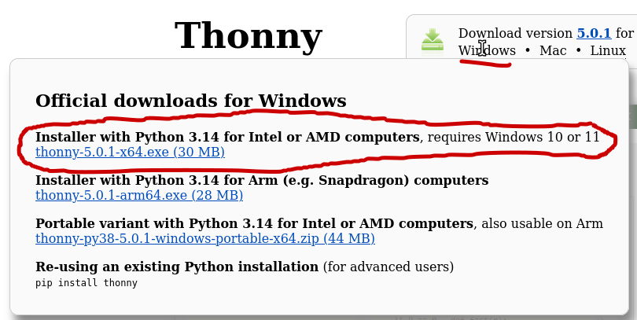
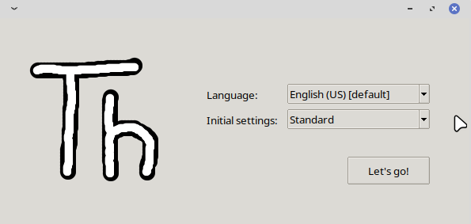
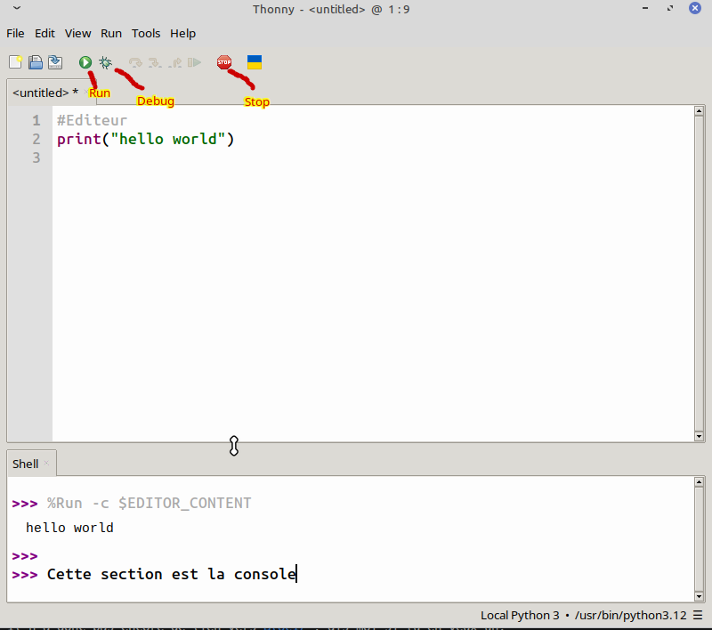

# 01 — Installer Thonny

**Ce qu'il te faut :** ton portable Windows et une connexion Internet.

**Thonny** est un éditeur Python pensé pour les débutants. Il installe Python en même temps que lui : tu n'as rien d'autre à installer. On l'utilise surtout pour son **debugger**, qui te montre ton programme s'exécuter ligne par ligne (tu le verras au [guide 04](04-debugger.md)).

> [!tip] Avant la première rencontre
> Si tu peux, fais ce guide **avant** la première rencontre. Ça prend 5 minutes, et on aura plus de temps pour programmer. Si ça bloque, pas de panique : on règle ça ensemble au début de la rencontre.

---

## 1. Télécharger et installer

1. Va sur [thonny.org](https://thonny.org).
2. En haut à droite, sous **Download version … for Windows**, clique sur le premier lien (l'installateur).
3. Ouvre le fichier téléchargé.
   - Si Windows affiche **« Windows a protégé votre ordinateur »**, clique sur **Informations complémentaires**, puis sur **Exécuter quand même**.
   - Si on te demande pour qui installer, choisis **Install for me only**. Ça ne demande pas de mot de passe administrateur.
4. Clique sur **Next** jusqu'à la fin en gardant les options par défaut, puis sur **Install** et **Finish**.



## 2. Premier lancement

1. Ouvre **Thonny** depuis le menu Démarrer.
2. Une petite fenêtre te demande la langue et les réglages :
   - **Language :** choisis **English (US)**. Les guides utilisent les noms des menus en anglais (**Run**, **View**…).
   - **Initial settings :** laisse **Standard**.
3. Clique sur **Let's go!**



## 3. Faire le tour de Thonny



| Zone | À quoi elle sert |
|---|---|
| **L'éditeur** (en haut) | C'est là que tu écris ton programme. Rien ne se passe tant que tu ne le lances pas. |
| **La console** (*Shell*, en bas) | C'est là que ton programme affiche ses messages et où tu tapes tes réponses. Tu peux aussi y taper une ligne de Python pour l'essayer tout de suite. |
| **Le bouton ▶** (*Run*, ou `F5`) | Il lance le programme écrit dans l'éditeur. |
| **Le bouton Debug** 🐞 (*Debug*, ou `Ctrl+F5`) | Il lance le programme pas à pas. On le verra au [guide 04](04-debugger.md). |
| **Le bouton ■** (*Stop*) | Il arrête un programme qui tourne. Utile si tu restes coincé. |

Ouvre aussi le panneau des variables tout de suite : menu **View → Variables**. Il apparaît à droite et te montre ce que ton programme garde en mémoire. Tu vas t'en servir souvent.

### Essaie la console

Clique dans la console, à côté de `>>>`, tape cette ligne et appuie sur **Entrée** :

```python
2 + 3
```

Python répond `5`. La console est parfaite pour essayer une petite chose rapidement. Mais elle ne garde rien : pour écrire un vrai programme, on utilise l'éditeur.

### Enregistre ton travail

1. Crée un dossier **Club-Programmation** dans tes **Documents**. Tous tes programmes du club iront là.
2. Dans Thonny, **File → Save** (`Ctrl+S`), va dans ce dossier et nomme ton fichier `carte.py`.

Le `.py` indique que c'est un programme Python. Thonny l'ajoute tout seul si tu l'oublies.

---

## Si ça ne fonctionne pas

**L'installation demande un mot de passe administrateur**
→ Recommence et choisis **Install for me only**. Si c'est toujours bloqué (ordinateur géré par l'école), ne cherche pas à contourner le blocage : utilise l'éditeur en ligne ci-dessous en attendant, et parles-en à l'animateur.

**Je ne peux pas installer Thonny du tout**
→ Va sur [online-python.com](https://www.online-python.com). Tu peux y écrire et lancer tes programmes (bouton **Run**), y compris ceux qui utilisent `input`. Il n'y a pas de debugger : dès que tu peux, installe Thonny.

**Thonny est en français (ou une autre langue)**
→ **Outils → Options → Général** (*Tools → Options → General*), change la langue pour **English (US)**, puis redémarre Thonny.

---

Suite : [02 — Ton premier programme : `print` et `input`](02-print-input.md)
