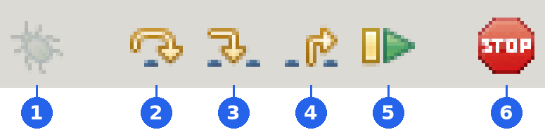
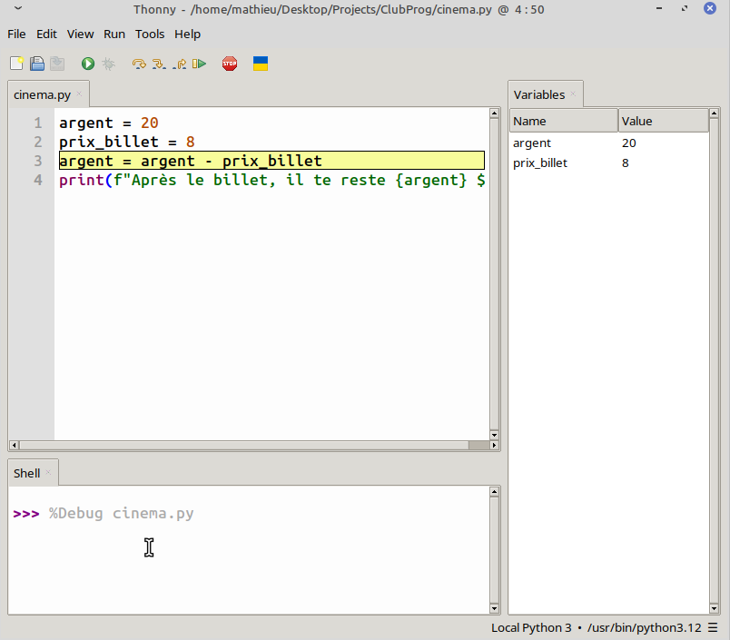
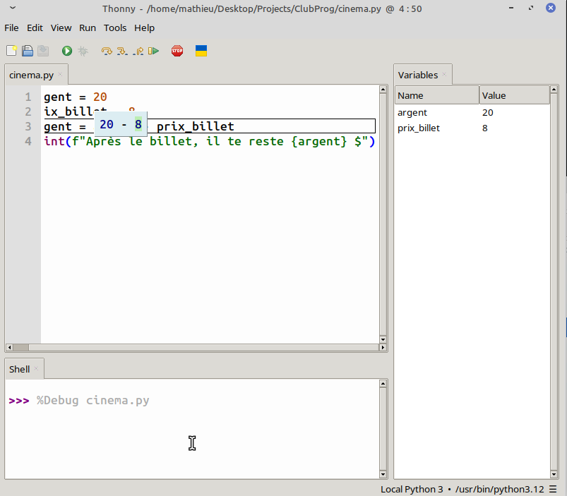

# 04 — Le debugger

**Ce que tu vas apprendre :** exécuter ton programme **une ligne à la fois** et voir tes variables changer pendant qu'il tourne.

Quand tu cliques sur ▶, ton programme s'exécute en une fraction de seconde. Tu vois le résultat, mais pas ce qui s'est passé entre-temps. Le **debugger** ralentit tout : c'est toi qui décides quand Python passe à l'étape suivante.

Il sert à deux choses :

- **comprendre** un programme, le tien ou celui de quelqu'un d'autre ;
- **trouver un bug** : l'endroit exact où une variable prend une valeur que tu n'attendais pas.

C'est la raison principale pour laquelle on utilise Thonny : son debugger est l'un des plus visuels qui existent.

---

## Les boutons

Ils sont dans la barre d'outils, à droite du ▶.



| # | Bouton | Raccourci | Ce qu'il fait |
|---|---|---|---|
| 1 | 🐞 **Debug** | `Ctrl+F5` | Lance le programme en mode pas à pas. Il s'arrête sur la première ligne. |
| 2 | **Step over** | `F6` | Exécute la ligne surlignée au complet, puis s'arrête à la suivante. |
| 3 | **Step into** | `F7` | Entre **dans** la ligne : montre le calcul morceau par morceau. |
| 4 | **Step out** | | Termine le morceau en cours et revient d'un niveau. Utile quand tu es entré trop loin avec `F7`. |
| 5 | **Resume** | `F8` | Exécute le reste du programme normalement. |
| 6 | **Stop** | `Ctrl+F2` | Arrête tout. |

> [!tip] Le bug est gris ?
> Pendant que le debugger tourne, le bouton 🐞 devient gris : le programme est déjà en mode pas à pas. Il redevient coloré quand le programme est terminé ou arrêté.

## Essaie-le

Ouvre le panneau **View → Variables** s'il n'est pas déjà ouvert. Écris ce programme dans un nouveau fichier `cinema.py` :

```python
argent = 20
prix_billet = 8
argent = argent - prix_billet
print(f"Après le billet, il te reste {argent} $")
```

1. Clique sur 🐞 (`Ctrl+F5`). La première ligne est surlignée : elle **n'est pas encore exécutée**. Le panneau Variables est vide.
2. Appuie sur `F6`. La ligne s'exécute : `argent` apparaît dans le panneau avec la valeur `20`.
3. Appuie encore sur `F6` : `prix_billet` apparaît.
4. Avant d'appuyer sur `F6` pour la 3ᵉ ligne, **devine** : quelle sera la nouvelle valeur de `argent` ? Vérifie.
5. Continue jusqu'à la fin.



> [!tip] Si ton programme utilise `input`
> Quand le debugger arrive sur un `input`, il attend ta réponse. Clique dans la console, tape ta réponse, appuie sur **Entrée**, puis continue avec `F6`.

## Voir un calcul de l'intérieur : `Step into`

Relance le debugger (`Ctrl+F5`) et avance avec `F6` jusqu'à la ligne `argent = argent - prix_billet`. Cette fois, appuie sur `F7` plusieurs fois.

Thonny encadre chaque morceau du calcul et remplace les noms par leurs valeurs, étape par étape :

```
argent - prix_billet
20 - prix_billet
20 - 8
12
```

C'est comme ça que Python évalue chaque ligne. Quand un calcul te donne un résultat bizarre, `F7` te montre exactement où ça déraille.



---

### Exercice 1 — Le bug du cinéma

Ce programme devrait dire qu'il te reste **7 $**. Il dit **3 $**. Copie-le, puis **trouve le bug avec le debugger**, sans relire le code ligne par ligne : avance avec `F6` et surveille `argent` dans le panneau Variables.

```python
argent = 20
prix_billet = 8
argent = argent - prix_billet
prix_popcorn = 5
argent = prix_billet - prix_popcorn
print(f"Il te reste {argent} $")
```

À quelle ligne `argent` prend-il une mauvaise valeur ? Corrige-la.

### Exercice 2 — La moyenne qui ment

Ce programme calcule la moyenne de trois notes. Avec `80`, `90` et `70`, il devrait afficher `80.0`. Il affiche `193.33333333333334`.

```python
note1 = 80
note2 = 90
note3 = 70
moyenne = note1 + note2 + note3 / 3
print(moyenne)
```

Utilise `F7` (Step into) sur la ligne de la moyenne. Dans quel ordre Python fait-il les calculs ? Corrige le programme.

> [!tip] Indice
> Comme en maths, Python fait les multiplications et les divisions **avant** les additions. Les parenthèses changent l'ordre.

### Exercice 3 — Ta carte au ralenti

Lance ta carte d'identité (`carte.py`) dans le debugger. Avance avec `F6` et réponds aux questions dans la console. Regarde le type de chaque valeur dans le panneau Variables : est-ce que `age` est bien un `int` ?

## Défi bonus

Demande à ton voisin d'écrire un programme de 5 à 6 lignes avec un bug caché (une mauvaise variable, un mauvais calcul…). Échangez vos ordinateurs et trouvez le bug de l'autre **uniquement avec le debugger**.

> [!important] Garde le réflexe
> À partir de maintenant, quand ton programme ne fait pas ce que tu veux, ton premier réflexe devrait être 🐞, pas de relire le code dix fois. Les guides suivants te proposent de regarder tes conditions et tes boucles dans le debugger : c'est là qu'il devient vraiment impressionnant.

---

Suite : [05 — Les conditions](05-conditions.md)
