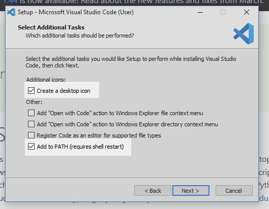
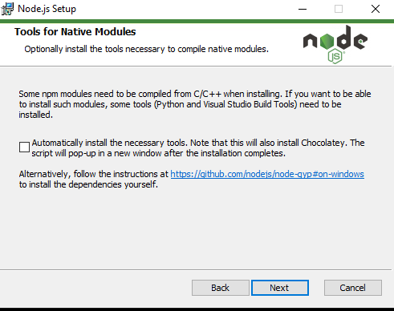
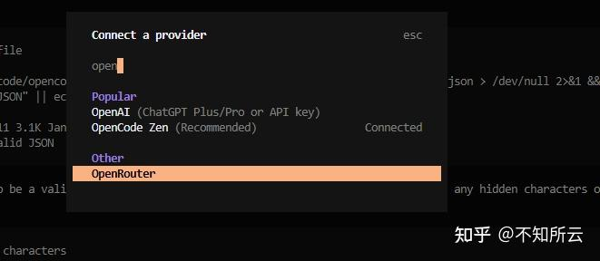

# 02 — Installer OpenCode

**Ce qu'il te faut :** ton portable Windows, une connexion Internet et ta clé OpenRouter ([guide 01](01-cle-openrouter.md)).

On va installer quatre choses :

| Outil | À quoi il sert |
|---|---|
| **VS Code** | L'éditeur où tout se passe. Tu l'apprendras en détail au bloc 3. |
| **Node.js** | Un programme qui sert à installer OpenCode et le skill `teach`. Tu ne t'en serviras pas directement. |
| **OpenCode** | L'agent IA. Il fonctionne dans le terminal de VS Code. |
| **Le modèle** | Le « cerveau » de l'IA, fourni par OpenRouter. |

> [!tip] Le terminal, c'est quoi ?
> Une fenêtre où tu tapes des **commandes** au lieu de cliquer. Dans ce guide, chaque commande est dans un encadré gris comme celui-ci :
> ```powershell
> node --version
> ```
> Pour l'exécuter : copie-la, colle-la dans le terminal (clic droit ou `Ctrl+V`), puis appuie sur **Entrée**. Tape-la exactement comme elle est écrite.

---

## 1. Installer VS Code

1. Va sur [code.visualstudio.com](https://code.visualstudio.com) et clique sur **Download for Windows**.
2. Ouvre le fichier téléchargé. Accepte la licence, puis clique sur **Next** jusqu'à la fin en gardant les options par défaut.
   - Vérifie que **Add to PATH** est bien coché (c'est le cas par défaut).
3. Clique sur **Finish**. VS Code s'ouvre.



> [!tip] VS Code en français
> VS Code peut te proposer d'installer le module de langue française. Tu peux accepter, mais ce guide utilise les noms en anglais (**Terminal**, **File**…). En français, cherche l'équivalent (**Terminal**, **Fichier**…).

## 2. Installer Node.js

1. Va sur [nodejs.org](https://nodejs.org) et télécharge la version **LTS** (le gros bouton, version 24 ou plus).
2. Ouvre le fichier téléchargé et clique sur **Next** en gardant les options par défaut.
3. À l'écran **Tools for Native Modules**, **ne coche pas** la case. Ce n'est pas nécessaire et ça installe beaucoup de choses en plus.
4. Clique sur **Install**, accepte la demande de Windows, puis **Finish**.



> [!important] Redémarre VS Code
> Ferme **complètement** VS Code et rouvre-le. Sinon, il ne « voit » pas encore Node.js.

## 3. Installer OpenCode

### Créer ton dossier d'apprentissage

1. Ouvre l'**Explorateur de fichiers** et va dans **Documents**.
2. Crée un dossier nommé `Apprentissage`.
3. Dans VS Code : **File → Open Folder…**, choisis `Documents\Apprentissage` et clique sur **Sélectionner un dossier**.
4. Si VS Code te demande « Do you trust the authors of the files in this folder? », clique sur **Yes, I trust the authors**.

### Ouvrir le terminal

Dans VS Code : **Terminal → New Terminal** (ou `Ctrl+ù` / `` Ctrl+` `` selon ton clavier). Un panneau s'ouvre en bas, avec une ligne qui ressemble à :

```
PS C:\Users\TonNom\Documents\Apprentissage>
```

C'est **PowerShell**, le terminal de Windows. Vérifie que Node.js est bien installé :

```powershell
node --version
```

Tu devrais voir un numéro comme `v24.22.1`. Si tu vois une erreur, va au [dépannage](#dépannage).

### Autoriser npm (une seule fois)

Par défaut, Windows bloque certains scripts, dont `npm`, l'outil qui installe OpenCode. Cette commande les autorise **pour ton compte seulement** (pas besoin d'être administrateur) :

```powershell
Set-ExecutionPolicy -ExecutionPolicy RemoteSigned -Scope CurrentUser
```

Si PowerShell te pose une question, tape `O` (ou `Y`) puis **Entrée**.

### Installer OpenCode

```powershell
npm install -g opencode-ai
```

Ça prend une minute. Ensuite, vérifie :

```powershell
opencode --version
```

Tu devrais voir un numéro de version (par exemple `1.19.3`).

## 4. Connecter OpenRouter

1. Dans le terminal de VS Code, lance OpenCode :

   ```powershell
   opencode
   ```

   La première fois, VS Code installe aussi l'**extension OpenCode** automatiquement. L'interface d'OpenCode s'affiche dans le terminal, avec une zone de texte en bas.

2. Dans la zone de texte, tape `/connect` et appuie sur **Entrée**.
3. Tape `openrouter` pour filtrer la liste, choisis **OpenRouter** avec les flèches et appuie sur **Entrée**.
4. Colle ta clé (`Ctrl+V` ou clic droit) et appuie sur **Entrée**.



5. Quitte OpenCode pour la prochaine étape : tape `/exit` puis **Entrée** (ou `Ctrl+C`).

Ta clé est maintenant enregistrée sur ton portable. Tu peux détruire le papier ou le message où elle était écrite.

## 5. Choisir le modèle

On va dire à OpenCode quel modèle gratuit utiliser, grâce à un fichier de configuration.

1. Dans le terminal, crée le dossier de configuration et ouvre le fichier dans VS Code :

   ```powershell
   New-Item -ItemType Directory -Force "$env:USERPROFILE\.config\opencode"
   code "$env:USERPROFILE\.config\opencode\opencode.json"
   ```

2. Un fichier vide s'ouvre dans VS Code. Colles-y **exactement** ceci :

   ```json
   {
     "$schema": "https://opencode.ai/config.json",
     "model": "openrouter/thinkingmachines/inkling:free",
     "small_model": "openrouter/thinkingmachines/inkling:free",
     "provider": {
       "openrouter": {
         "models": {
           "thinkingmachines/inkling:free": {},
           "nvidia/nemotron-3-ultra-550b-a55b:free": {},
           "minimax/minimax-m3.1-flash:free": {}
         }
       }
     }
   }
   ```

3. Enregistre avec `Ctrl+S`, puis ferme l'onglet.

Ce fichier choisit **Inkling** comme modèle principal et ajoute deux modèles de secours, tous gratuits (`:free`).

> [!important] Toujours `:free`
> Un modèle sans `:free` à la fin de son nom est **payant**. Ta clé ne permet pas de payer, donc il ne fonctionnera pas.

## 6. Les règles du tuteur

On ajoute maintenant un fichier d'instructions qu'OpenCode lit **à chaque conversation**, peu importe le dossier où tu es.

1. Dans le terminal :

   ```powershell
   code "$env:USERPROFILE\.config\opencode\AGENTS.md"
   ```

2. Colle ceci dans le fichier, puis enregistre (`Ctrl+S`) :

   ```markdown
   # Règles

   - Réponds toujours en français.
   - Je suis un élève du secondaire qui apprend à programmer. Tu es mon tuteur.
   - Explique les notions et les erreurs, pose-moi des questions, donne-moi des indices.
   - N'écris jamais à ma place le code de mes exercices ou de mes projets.
     Si je te le demande, rappelle-moi la règle et aide-moi à trouver la solution moi-même.
   - Tu peux créer et modifier les fichiers de leçons, de notes et de référence du skill teach.
   ```

Ce fichier met par écrit la règle de l'IA du club. Au bloc 5, quand tu programmeras avec l'IA, on le modifiera.

## 7. Premier test

1. Relance OpenCode :

   ```powershell
   opencode
   ```

2. En bas à droite, vérifie que le modèle affiché est **Inkling**.
3. Écris ce message et appuie sur **Entrée** :

   ```
   Explique-moi en deux phrases ce qu'est une variable en Python.
   ```

4. L'IA devrait répondre **en français**, en quelques secondes ou un peu plus.


Si ça fonctionne, bravo : ton tuteur IA est installé. Passe au [guide 03](03-skill-teach.md).

---

## Changer de modèle ou de clé

**Changer de modèle (pour une conversation) :** dans OpenCode, tape `/models`, tape une partie du nom (`nemotron`, `minimax`…) et choisis-le. Utile quand Inkling est surchargé ou atteint sa limite.

**Changer de modèle (par défaut) :** ouvre ton fichier de configuration…

```powershell
code "$env:USERPROFILE\.config\opencode\opencode.json"
```

…et remplace le nom après `"model":` et `"small_model":` par celui d'un des modèles de la liste, précédé de `openrouter/`. Par exemple : `"openrouter/minimax/minimax-m3.1-flash:free"`.

**Ajouter un autre modèle gratuit :** trouve-le sur [openrouter.ai/models](https://openrouter.ai/models?max_price=0) (filtre « gratuit »). Copie son nom (il finit par `:free`) et ajoute une ligne dans la liste `"models"`, sur le modèle des autres. Attention aux virgules : chaque ligne finit par une virgule, sauf la dernière.

**Changer de clé :** refais l'étape [4. Connecter OpenRouter](#4-connecter-openrouter) avec ta nouvelle clé.

> [!tip] Quel modèle choisir ?
> Les modèles gratuits changent souvent : certains disparaissent, d'autres apparaissent. Si un modèle de la liste ne répond plus, demande à l'animateur lequel utiliser.

---

## Dépannage

**`node` / `npm` / `opencode` n'est pas reconnu** (« is not recognized as the name of a cmdlet »)
→ Ferme complètement VS Code et rouvre-le. Si ça ne règle rien, réinstalle Node.js (étape 2) en gardant les options par défaut.

**« running scripts is disabled on this system »**
→ Tu as sauté l'étape [Autoriser npm](#autoriser-npm-une-seule-fois). Exécute la commande `Set-ExecutionPolicy`, puis réessaie.

**`Set-ExecutionPolicy` refuse de fonctionner** (message qui parle de « Group Policy » ou d'une politique remplacée)
→ Ton ordinateur est géré par ton école. Utilise `npm.cmd` et `npx.cmd` au lieu de `npm` et `npx` :

```powershell
npm.cmd install -g opencode-ai
```

**L'installation elle-même est bloquée** (Node.js ou VS Code refuse de s'installer, accès administrateur demandé)
→ Ne cherche pas à contourner le blocage. Parles-en à l'animateur.

**« No endpoints found matching your data policy »**
→ Un réglage du compte du club bloque ce modèle. Avertis l'animateur.

**« Rate limit exceeded » ou erreur 429**
→ Une limite est atteinte. Attends une minute, essaie un autre modèle avec `/models` ou reviens le lendemain.

**Erreur qui parle de crédits, de paiement ou d'erreur 402**
→ Le modèle choisi n'est pas gratuit. Vérifie qu'il finit par `:free` (voir [Changer de modèle](#changer-de-modèle-ou-de-clé)).

**« Invalid API key », « Unauthorized » ou erreur 401**
→ La clé est mal collée ou a été désactivée. Refais l'étape [4](#4-connecter-openrouter). Si ça ne fonctionne toujours pas, demande une nouvelle clé à l'animateur.

---

Suite : [03 — Le skill `teach`](03-skill-teach.md)
